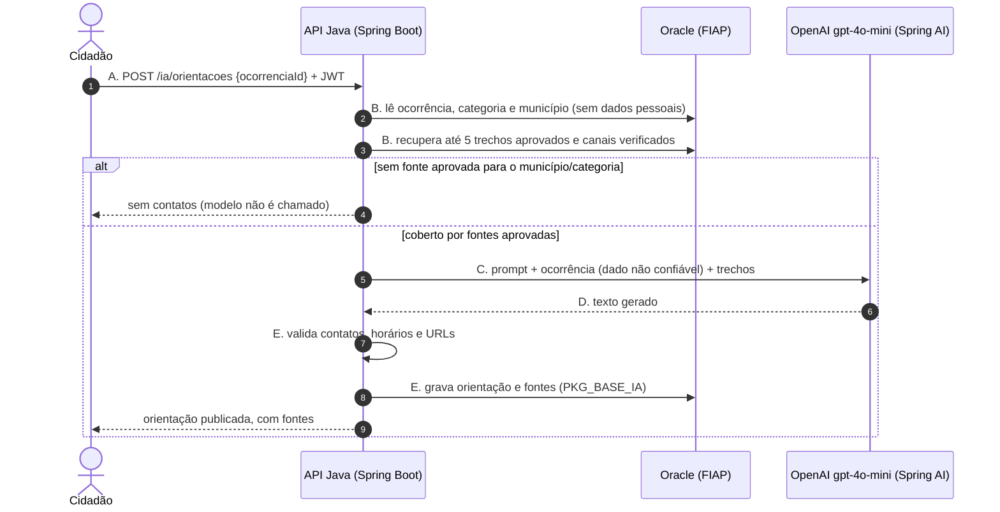

# Bairro Vivo — Orientação cidadã com IA generativa e RAG

**Global Solution 2026/2 · CitizenTech · Disruptive Architectures: IoT, IoB & Generative IA**

Funcionalidade de IA do Bairro Vivo: a partir de uma ocorrência registrada pelo cidadão, a API Java gera uma **orientação sobre o canal oficial adequado**, usando um modelo generativo com **RAG** sobre fontes oficiais aprovadas.

## 1. Identificação

| RM | Nome completo |
|---|---|
| 566385 | Diego Andrade dos Santos |
| 561529 | Grazielle de Alencar Silva |
| 564870 | Julia Corrêa e Souza |
| 565572 | Rafael Kubagawa Ramos |
| 566230 | Vinícius Soteras Braga |

- Repositório (este): https://github.com/FIAP-BAIRRO-VIVO/fiap-bairro-vivo-ai
- API em produção (Swagger): https://bairro-vivo-java-566385.azurewebsites.net/swagger-ui.html
- Entrega de DevOps e Cloud Computing (pipelines, infraestrutura): https://github.com/FIAP-BAIRRO-VIVO/fiap-bairro-vivo-devops

## 2. Aplicação ao problema

**Tema CitizenTech.** O Bairro Vivo é uma plataforma colaborativa de zeladoria: o cidadão registra problemas do seu bairro (ocorrências) e acompanha o que acontece com eles.

**Problema.** Quem registra uma ocorrência muitas vezes não sabe **a quem recorrer**: qual é o canal oficial, para qual tipo de problema e em qual município. O registro fica sem encaminhamento, e a ocorrência se perde.

**Público beneficiado.** Cidadãos do município de São Paulo que registram ocorrências urbanas. Indiretamente, o poder público também ganha, porque recebe demandas mais bem encaminhadas.

**Contribuição para a solução.** A IA transforma a ocorrência em um próximo passo concreto: indica o canal oficial adequado, a partir de fontes aprovadas, e deixa a orientação consultável por qualquer pessoa depois de publicada.

## 3. A funcionalidade

`POST /api/v1/ia/orientacoes` recebe apenas o `ocorrenciaId`. A API lê a ocorrência no Oracle, recupera as fontes oficiais aprovadas, chama o modelo, valida a resposta e a grava com as fontes usadas. Somente orientações **publicadas** podem ser lidas por `GET /api/v1/ia/orientacoes/{id}` e `GET /api/v1/ia/orientacoes/ocorrencias/{ocorrenciaId}`.

## 4. IA generativa no fluxo da aplicação

- **Modelo:** `gpt-4o-mini` (OpenAI), por API, integrado pelo **Spring AI**.
- **Integração:** o modelo é chamado dentro do fluxo de `POST /ia/orientacoes`, depois da recuperação das fontes e antes da validação e da gravação.
- **Ativação:** desabilitado por padrão. Só roda com `BAIRROVIVO_AI_ENABLED=true` e `OPENAI_API_KEY`. Se habilitado sem credencial, a aplicação falha na inicialização, de forma explícita.
- **Falha do modelo:** a API devolve erro `503` padronizado e registra o estado `ERRO`. Ela **nunca devolve uma resposta fictícia**.

**Por que API e não modelo local:** o `gpt-4o-mini` tem bom desempenho em português, baixo custo e baixa latência, e dispensa infraestrutura com GPU. O Spring AI abstrai o provedor, então trocar por outro modelo (inclusive local) exige poucas mudanças.

## 5. Aprofundamento técnico: RAG

**O que é RAG.** *Retrieval-Augmented Generation* é a técnica em que o modelo **consulta uma base de documentos confiáveis antes de responder**, em vez de responder só com o que aprendeu no treinamento. O modelo não é retreinado: para atualizar o conhecimento, atualiza-se a base.

**Como funciona no Bairro Vivo:**

1. **Contexto:** a API lê `TB_OCORRENCIA`, `TB_CATEGORIA` e `TB_MUNICIPIO`, sem incluir dados pessoais do autor. Ocorrências excluídas não são elegíveis.
2. **Recuperação:** busca até **5 trechos** em `VW_TRECHOS_RAG_APROVADOS` e os canais com `FL_VERIFICADO = 'S'`.
3. **Portão de elegibilidade:** o modelo só é chamado se o município e a categoria estiverem cobertos por fontes aprovadas.
4. **Geração:** a instrução trata a descrição da ocorrência como **dado não confiável**, bloqueia *prompt injection* e proíbe inventar contatos e horários.
5. **Validação da saída:** a resposta é rejeitada se contiver número de contato, horário ou URL que não esteja nas fontes aprovadas.
6. **Persistência:** a orientação e as fontes são gravadas por `PKG_BASE_IA.PR_REGISTRAR_ORIENTACAO`.

**Por que RAG:**

- Os canais e contatos mudam, e o RAG permite atualizá-los sem retreinar o modelo.
- Reduz alucinação, que é crítica quando o cidadão age com base na resposta.
- A resposta é **rastreável** até uma fonte oficial.
- A base é pequena e curada, então um pipeline simples é suficiente.

**Por que não Machine Learning, Deep Learning ou Visão Computacional nesta versão:** o problema é de recuperação e redação de informação textual sobre canais oficiais, e não de classificação ou predição. Não há base rotulada para treino, e o RAG resolve o caso sem esse custo. A visão computacional (fotos das ocorrências, tratadas pela API .NET) fica como evolução.

## 6. Dados e arquitetura

### Fontes de dados

| Fonte | Conteúdo | Origem | Preparação |
|---|---|---|---|
| _Nome da fonte_ | _Canais, telefones, horários_ | _Órgão e URL_ | _Limpeza, divisão em trechos, verificação_ |
| `TB_OCORRENCIA` / `TB_CATEGORIA` / `TB_MUNICIPIO` | Ocorrências, categorias e municípios | Gravados pela API .NET no Oracle compartilhado | Leitura somente com permissão de consulta |

O esquema fica no Oracle e **não é criado pela aplicação** (`ddl-auto=none`). Ver `Dicionario_Dados_Integracao.md` e `scripts/script-bd.sql`.

### Fluxo entre aplicação, modelo e serviços



### Arquitetura geral


| Componente | Papel |
|---|---|
| Azure Web App (Linux B1) | Executa a API Java com o módulo de orientação (Spring AI + RAG) |
| Oracle (FIAP) | Guarda ocorrências, fontes aprovadas e orientações |
| OpenAI API | Gera o texto da orientação a partir do contexto recuperado |
| API .NET (Render) | Registra ocorrências, votos, fotos e relatórios no Oracle |
| RabbitMQ (Azure Container Instances) | Recebe o evento `usuario.cadastrado` |
| Azure DevOps | Boards, Repos e Pipelines de CI/CD (ver README de DevOps) |

## 7. Modelos e tecnologias

| Item | Tecnologia |
|---|---|
| Linguagem e framework | Java 17, Spring Boot 3.4.4 |
| IA generativa | Spring AI 1.0.0 com OpenAI (`gpt-4o-mini`) |
| Recuperação (RAG) | _Descrever (view `VW_TRECHOS_RAG_APROVADOS`, ranking etc.)_ |
| Banco | Oracle (FIAP) via JDBC |
| Segurança | Spring Security, JWT RS256 |
| Documentação da API | springdoc-openapi (Swagger UI) |
| Testes | JUnit, H2 |

## 8. Avaliação dos resultados

### Casos de teste

| # | Entrada | Resultado esperado | Como verificar | Resultado obtido |
|---|---|---|---|---|
| 1 | Ocorrência com município e categoria cobertos | Orientação publicada, contatos só das fontes aprovadas | Postman/curl | _preencher_ |
| 2 | Município sem fonte aprovada | Resposta sem contatos, modelo não chamado | Postman/curl | _preencher_ |
| 3 | Categoria sem fonte aprovada | Resposta sem contatos | Postman/curl | _preencher_ |
| 4 | Descrição com *prompt injection* ("ignore as instruções…") | Descrição tratada como dado, instrução ignorada | Postman/curl | _preencher_ |
| 5 | Modelo devolve telefone, horário ou URL fora das fontes | Resposta rejeitada pela validação | Teste automatizado | _preencher_ |
| 6 | Ocorrência marcada como excluída | Não elegível, erro padronizado | Postman/curl | _preencher_ |
| 7 | `ocorrenciaId` inexistente | Erro padronizado | Postman/curl | _preencher_ |
| 8 | Modelo indisponível ou sem credencial | `503` padronizado, estado `ERRO`, sem resposta fictícia | Teste automatizado | _preencher_ |
| 9 | Mais de 5 solicitações em 1 minuto | Solicitação bloqueada pelo limite | Script de chamadas | _preencher_ |
| 10 | Chamada sem token | `401` com `NAO_AUTENTICADO` | Postman/curl | _preencher_ |

### Métricas e critérios

| Critério | Como medir | Meta | Resultado |
|---|---|---|---|
| Respostas fundamentadas | % de respostas cujos contatos, horários e URLs estão nas fontes aprovadas | 100% | _preencher_ |
| Rejeições pela validação | Nº de respostas barradas por contato fora das fontes | Registrar | _preencher_ |
| Cobertura | % de ocorrências do conjunto de teste elegíveis ao RAG | Registrar | _preencher_ |
| Falhas controladas | Falhas do modelo que viram `503` e não resposta inventada | 100% | _preencher_ |
| Latência | Tempo de resposta de `POST /ia/orientacoes` (mediana) | Registrar | _preencher_ |

### Análise dos resultados

_Resumir o que funcionou, o que falhou e o que foi ajustado._

## 9. Uso responsável e limitações

**Cuidados adotados**

- Dados pessoais do autor da ocorrência **não são enviados** ao modelo.
- Credenciais e chaves em variáveis de ambiente. Chaves RSA, `.env` e `.secrets/` ficam fora do Git, e o repositório traz só o `.env.example`.
- A saída do modelo é validada antes de ser persistida e entregue.
- A descrição da ocorrência é tratada como não confiável (defesa contra *prompt injection*).
- Limite de 5 solicitações por minuto por usuário (por instância da API).

**Limitações**

- Orientações limitadas ao **município de São Paulo** nesta versão.
- A qualidade da resposta depende da qualidade e da atualização das fontes aprovadas.
- O modelo pode interpretar mal a ocorrência, mesmo com contexto, e a validação cobre contatos, horários e URLs, e não o sentido do texto.
- Depende de um serviço externo (OpenAI) e de uma credencial válida.
- O limite de solicitações é por instância. Com várias instâncias, seria preciso um limitador compartilhado.
- A orientação é **informativa** e não substitui a confirmação no canal oficial.

## 10. Como executar

**Pré-requisitos:** JDK 17, Docker (RabbitMQ), Oracle com o esquema do projeto e chaves RSA em `.secrets/` (fora do Git).

```bash
cp .env.example .env
docker compose up -d rabbitmq
./mvnw spring-boot:run
./mvnw test
```

Swagger: `http://localhost:8080/swagger-ui.html`. Coleção do Postman: `postman/Bairro-Vivo-Java.postman_collection.json`.

**Variáveis de ambiente (apenas os nomes):** `ORACLE_URL`, `ORACLE_USER`, `ORACLE_PASSWORD`, `JWT_ISSUER`, `JWT_AUDIENCE`, `JWT_TTL`, `JWT_PRIVATE_KEY_PATH`, `JWT_PUBLIC_KEY_PATH`, `RABBITMQ_HOST`, `RABBITMQ_PORT`, `RABBITMQ_USER`, `RABBITMQ_PASSWORD`, `DOTNET_API_BASE_URL`, `DOTNET_OCCURRENCE_PATH`, `DOTNET_SERVICE_TOKEN`, `BAIRROVIVO_AI_ENABLED`, `OPENAI_API_KEY`, `OPENAI_MODEL`.

**Testar a orientação:**

1. `POST /api/v1/auth/registrar` devolve um `accessToken`.
2. `POST /api/v1/ia/orientacoes` com `{"ocorrenciaId": <id>}` e o cabeçalho `Authorization: Bearer <accessToken>`.
3. Requer ocorrência gravada pela API .NET no Oracle, fontes aprovadas cadastradas e a IA habilitada.

## 11. Uso de IA no desenvolvimento

A IA foi usada como apoio à estrutura do código, aos testes e à documentação. O código sugerido foi tratado como proposta, revisado e validado pela equipe, que mantém a responsabilidade pelas decisões de arquitetura, segurança e integração.
