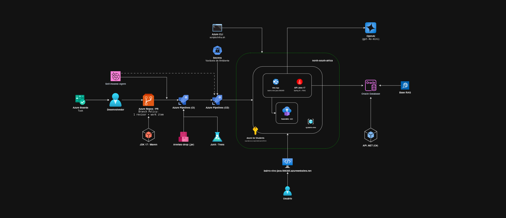

# Bairro Vivo — Orientação cidadã com IA generativa e RAG

**Global Solution 2026/2 · CitizenTech · Disruptive Architectures: IoT, IoB & Generative IA**

Funcionalidade de IA do Bairro Vivo: a partir de uma ocorrência registrada pelo cidadão, a API Java gera uma **orientação sobre o canal oficial adequado**, usando um modelo generativo com **RAG** sobre fontes oficiais aprovadas.

## 1. Identificação

| RM | Nome completo |
|---|---|
| 566385 | Diego Andrade dos Santos |
| 561529 | Grazielle de Alencar Silva |
| 564870 | Julia Corrêa e Souza |
| 565572 | Rafael Kubagawa Ramos |
| 566230 | Vinícius Soteras Braga |

- Repositório (este): https://github.com/FIAP-BAIRRO-VIVO/fiap-bairro-vivo-ai
- API em produção (Swagger): https://bairro-vivo-java-566385.azurewebsites.net/swagger-ui.html
- Entrega de DevOps e Cloud Computing (pipelines, infraestrutura): https://github.com/FIAP-BAIRRO-VIVO/fiap-bairro-vivo-devops

## 2. Aplicação ao problema

**Tema CitizenTech.** O Bairro Vivo é uma plataforma colaborativa de zeladoria: o cidadão registra problemas do seu bairro (ocorrências) e acompanha o que acontece com eles.

**Problema.** Quem registra uma ocorrência muitas vezes não sabe **a quem recorrer**: qual é o canal oficial, para qual tipo de problema e em qual município. O registro fica sem encaminhamento, e a ocorrência se perde.

**Público beneficiado.** Cidadãos do município de São Paulo que registram ocorrências urbanas. Indiretamente, o poder público também ganha, porque recebe demandas mais bem encaminhadas.

**Contribuição para a solução.** A IA transforma a ocorrência em um próximo passo concreto: indica o canal oficial adequado, a partir de fontes aprovadas, e deixa a orientação consultável por qualquer pessoa depois de publicada.

## 3. A funcionalidade

`POST /api/v1/ia/orientacoes` recebe apenas o `ocorrenciaId`. A API lê a ocorrência no Oracle, recupera as fontes oficiais aprovadas, chama o modelo, valida a resposta e a grava com as fontes usadas. Somente orientações **publicadas** podem ser lidas por `GET /api/v1/ia/orientacoes/{id}` e `GET /api/v1/ia/orientacoes/ocorrencias/{ocorrenciaId}`.

## 4. IA generativa no fluxo da aplicação

- **Modelo:** `gpt-4o-mini` (OpenAI), por API, integrado pelo **Spring AI**.
- **Integração:** o modelo é chamado dentro do fluxo de `POST /ia/orientacoes`, depois da recuperação das fontes e antes da validação e da gravação.
- **Ativação:** desabilitado por padrão. Só roda com `BAIRROVIVO_AI_ENABLED=true` e `OPENAI_API_KEY`. Se habilitado sem credencial, a aplicação falha na inicialização, de forma explícita.
- **Falha do modelo:** a API devolve erro `503` padronizado e registra o estado `ERRO`. Ela **nunca devolve uma resposta fictícia**.

**Por que API e não modelo local:** o `gpt-4o-mini` tem bom desempenho em português, baixo custo e baixa latência, e dispensa infraestrutura com GPU. O Spring AI abstrai o provedor, então trocar por outro modelo (inclusive local) exige poucas mudanças.

## 5. Aprofundamento técnico: RAG

**O que é RAG.** *Retrieval-Augmented Generation* é a técnica em que o modelo **consulta uma base de documentos confiáveis antes de responder**, em vez de responder só com o que aprendeu no treinamento. O modelo não é retreinado: para atualizar o conhecimento, atualiza-se a base.

**Como funciona no Bairro Vivo:**

1. **Contexto:** a API lê `TB_OCORRENCIA`, `TB_CATEGORIA` e `TB_MUNICIPIO`, sem incluir dados pessoais do autor. Ocorrências excluídas não são elegíveis.
2. **Recuperação:** busca até **5 trechos** em `VW_TRECHOS_RAG_APROVADOS` e os canais com `FL_VERIFICADO = 'S'`.
3. **Portão de elegibilidade:** o modelo só é chamado se o município e a categoria estiverem cobertos por fontes aprovadas.
4. **Geração:** a instrução trata a descrição da ocorrência como **dado não confiável**, bloqueia *prompt injection* e proíbe inventar contatos e horários.
5. **Validação da saída:** a resposta é rejeitada se contiver número de contato, horário ou URL que não esteja nas fontes aprovadas.
6. **Persistência:** a orientação e as fontes são gravadas por `PKG_BASE_IA.PR_REGISTRAR_ORIENTACAO`.

**Por que RAG:**

- Os canais e contatos mudam, e o RAG permite atualizá-los sem retreinar o modelo.
- Reduz alucinação, que é crítica quando o cidadão age com base na resposta.
- A resposta é **rastreável** até uma fonte oficial.
- A base é pequena e curada, então um pipeline simples é suficiente.

**Por que não Machine Learning, Deep Learning ou Visão Computacional nesta versão:** o problema é de recuperação e redação de informação textual sobre canais oficiais, e não de classificação ou predição. Não há base rotulada para treino, e o RAG resolve o caso sem esse custo. A visão computacional (fotos das ocorrências, tratadas pela API .NET) fica como evolução.

## 6. Dados e arquitetura

### Fontes de dados

| Fonte | Conteúdo | Origem | Preparação |
|---|---|---|---|
| Fontes oficiais aprovadas (`VW_TRECHOS_RAG_APROVADOS`) | Trechos com canais e orientações por município e categoria | Cadastradas no Oracle pela equipe | Somente trechos aprovados e canais com `FL_VERIFICADO = 'S'` são recuperados (até 5 por consulta) |
| `TB_OCORRENCIA` / `TB_CATEGORIA` / `TB_MUNICIPIO` | Ocorrências, categorias e municípios | Gravados pela API .NET no Oracle compartilhado | Leitura somente com permissão de consulta, sem dados pessoais do autor |

O esquema fica no Oracle e **não é criado pela aplicação** (`ddl-auto=none`). Ver `Dicionario_Dados_Integracao.md` e `scripts/script-bd.sql`.

### Arquitetura

O fluxo da requisição, passo a passo, está descrito na seção 5. O diagrama abaixo mostra a arquitetura completa: esteira de CI/CD no Azure DevOps, Web App com a API Java (Spring AI + RAG), Oracle com a base de fontes aprovadas, OpenAI e a API .NET.

<p align="center">
  
</p>

<br>

| Componente | Papel |
|---|---|
| Azure Web App (Linux B1) | Executa a API Java com o módulo de orientação (Spring AI + RAG) |
| Oracle (FIAP) | Guarda ocorrências, fontes aprovadas e orientações |
| OpenAI API | Gera o texto da orientação a partir do contexto recuperado |
| API .NET (Render) | Registra ocorrências, votos, fotos e relatórios no Oracle |
| RabbitMQ (Azure Container Instances) | Recebe o evento `usuario.cadastrado` |
| Azure DevOps | Boards, Repos e Pipelines de CI/CD (ver README de DevOps) |

## 7. Modelos e tecnologias

| Item | Tecnologia |
|---|---|
| Linguagem e framework | Java 17, Spring Boot 3.4.4 |
| IA generativa | Spring AI 1.0.0 com OpenAI (`gpt-4o-mini`) |
| Recuperação (RAG) | View `VW_TRECHOS_RAG_APROVADOS` no Oracle: até 5 trechos aprovados por consulta, mais canais verificados (`FL_VERIFICADO = 'S'`) |
| Banco | Oracle (FIAP) via JDBC |
| Segurança | Spring Security, JWT RS256 |
| Documentação da API | springdoc-openapi (Swagger UI) |
| Testes | JUnit, H2 |

## 8. Avaliação dos resultados

Os testes abaixo foram executados com `curl` contra a API em produção (`https://bairro-vivo-java-566385.azurewebsites.net/api/v1`) em 19/11/2026. Cada chamada usou um usuário novo, registrado em `POST /auth/registrar`, para não esbarrar no limite de solicitações. Os casos sem resultado registrado **não foram executados** nesta entrega e não são dados como verificados.

### Casos de teste

| # | Entrada | Resultado esperado | Como verificar | Resultado obtido |
|---|---|---|---|---|
| 1 | Ocorrência com município e categoria cobertos | Orientação publicada, contatos só das fontes aprovadas | curl | **Não demonstrado.** As 5 ocorrências existentes (IDs 1 a 5) retornaram `SEM_FONTE`, então o caminho de geração não foi exercitado nesta execução |
| 2 | Município sem fonte aprovada | Resposta sem contatos, modelo não chamado | curl | **Atendido.** Ocorrências de Campinas (ID 2), Santo André (ID 4) e Santos (ID 5): `HTTP 201`, `estado: SEM_FONTE`, `canais: []`, `fontes: []` e texto "Nao encontramos fontes oficiais verificadas para esta localidade e categoria." |
| 3 | Categoria sem fonte aprovada | Resposta sem contatos | curl | **Parcial.** Ocorrências de São Paulo (IDs 1 e 3) retornaram o mesmo `SEM_FONTE` sem contatos. A resposta não diferencia falta de fonte por município e por categoria |
| 4 | Descrição com *prompt injection* | Descrição tratada como dado, instrução ignorada | curl | Não executado |
| 5 | Modelo devolve telefone, horário ou URL fora das fontes | Resposta rejeitada pela validação | Teste automatizado | Não executado |
| 6 | Ocorrência marcada como excluída | Não elegível, erro padronizado | curl | Não executado |
| 7 | `ocorrenciaId` inexistente | Erro padronizado | curl | **Atendido.** `HTTP 404`, `OCORRENCIA_NAO_ENCONTRADA`, com `correlationId`. Confirmado com os IDs 6 a 15 e com 999999999 |
| 8 | Modelo indisponível ou sem credencial | `503` padronizado, estado `ERRO`, sem resposta fictícia | Teste automatizado | Não executado |
| 9 | Mais de 5 solicitações em 1 minuto | Solicitação bloqueada pelo limite | Script de chamadas | Não executado |
| 10 | Chamada sem token | `401` com `NAO_AUTENTICADO` | curl | **Atendido.** `HTTP 401`, `NAO_AUTENTICADO` |

**Leitura pública (verificações adicionais):**

| Chamada | Resultado |
|---|---|
| `GET /ia/orientacoes/999999999` (orientação inexistente) | `HTTP 404`, `ORIENTACAO_NAO_ENCONTRADA` |
| `GET /ia/orientacoes/ocorrencias/999999999` (ocorrência sem orientação) | `HTTP 200` com página vazia (`totalElementos: 0`) |
| `GET /ia/orientacoes/ocorrencias/0` | `HTTP 500`, `ERRO_INTERNO` (defeito conhecido, ver limitações) |

### Métricas e critérios

| Critério | Como medir | Meta | Resultado |
|---|---|---|---|
| Cobertura | % de ocorrências do conjunto de teste elegíveis ao RAG | Registrar | 0 de 5 ocorrências testadas (IDs 1 a 5) tinham fontes aprovadas correspondentes |
| Respostas sem fonte controladas | Casos sem fonte que retornam `SEM_FONTE`, sem contatos e sem fontes | 100% | 5 de 5 |
| Erros padronizados | Casos de erro testados que retornam corpo com `codigo` e `correlationId` | 100% | 3 de 4 (404 de ocorrência, 404 de orientação e 401 passaram; `GET .../ocorrencias/0` retornou 500) |
| Respostas fundamentadas, rejeições pela validação, falhas controladas do modelo e latência | Ver tabela de metas | — | Não medidos nesta entrega, porque nenhuma orientação foi gerada pelo modelo na execução |

### Análise dos resultados

**O que funcionou.** A autenticação (`401` sem token) e o tratamento de ocorrência inexistente (`404` padronizado) responderam como esperado. Nas cinco ocorrências existentes, o portão de elegibilidade impediu respostas sem base: a API devolveu `SEM_FONTE`, sem contatos, sem fontes e com texto explícito, em vez de inventar um canal. Esse é o comportamento de segurança central do RAG.

**O que não foi demonstrado.** Nenhuma das ocorrências testadas tinha fontes aprovadas correspondentes no Oracle, então a chamada ao modelo, a validação da saída e a gravação de uma orientação publicada **não foram exercitadas** nesta execução. Os casos 1, 4, 5, 6, 8 e 9 ficaram sem teste. Por isso a qualidade das respostas geradas, a taxa de rejeição pela validação e a latência não foram medidas.

**O que foi encontrado.** `GET /ia/orientacoes/ocorrencias/0` retorna `500 ERRO_INTERNO`, quando o esperado seria uma lista vazia ou um `404`, como acontece com `999999999`. Não foi corrigido nesta versão.

## 9. Uso responsável e limitações

**Cuidados adotados**

- Dados pessoais do autor da ocorrência **não são enviados** ao modelo.
- Credenciais e chaves em variáveis de ambiente. Chaves RSA, `.env` e `.secrets/` ficam fora do Git, e o repositório traz só o `.env.example`.
- A saída do modelo é validada antes de ser persistida e entregue.
- A descrição da ocorrência é tratada como não confiável (defesa contra *prompt injection*).
- Limite de 5 solicitações por minuto por usuário (por instância da API).

**Limitações**

- Orientações limitadas ao **município de São Paulo** nesta versão.
- A qualidade da resposta depende da qualidade e da atualização das fontes aprovadas. Na execução de testes de 19/11/2026, as ocorrências existentes não tinham fontes aprovadas correspondentes e retornaram `SEM_FONTE`.
- O modelo pode interpretar mal a ocorrência, mesmo com contexto, e a validação cobre contatos, horários e URLs, e não o sentido do texto.
- Depende de um serviço externo (OpenAI) e de uma credencial válida.
- O limite de solicitações é por instância. Com várias instâncias, seria preciso um limitador compartilhado.
- A resposta `SEM_FONTE` não informa se faltou fonte por município ou por categoria.
- `GET /ia/orientacoes/ocorrencias/0` retorna `500` em vez de lista vazia ou `404`.
- A orientação é **informativa** e não substitui a confirmação no canal oficial.

## 10. Como executar

**Pré-requisitos:** JDK 17, Docker (RabbitMQ), Oracle com o esquema do projeto e chaves RSA em `.secrets/` (fora do Git).

```bash
cp .env.example .env
docker compose up -d rabbitmq
./mvnw spring-boot:run
./mvnw test
```

Swagger: `http://localhost:8080/swagger-ui.html`. Coleção do Postman: `postman/Bairro-Vivo-Java.postman_collection.json`.

**Variáveis de ambiente (apenas os nomes):** `ORACLE_URL`, `ORACLE_USER`, `ORACLE_PASSWORD`, `JWT_ISSUER`, `JWT_AUDIENCE`, `JWT_TTL`, `JWT_PRIVATE_KEY_PATH`, `JWT_PUBLIC_KEY_PATH`, `RABBITMQ_HOST`, `RABBITMQ_PORT`, `RABBITMQ_USER`, `RABBITMQ_PASSWORD`, `BAIRROVIVO_AI_ENABLED`, `OPENAI_API_KEY`, `OPENAI_MODEL`.

**Testar a orientação:**

1. `POST /api/v1/auth/registrar` devolve um `accessToken`.
2. `POST /api/v1/ia/orientacoes` com `{"ocorrenciaId": <id>}` e o cabeçalho `Authorization: Bearer <accessToken>`.
3. Requer ocorrência gravada pela API .NET no Oracle, fontes aprovadas cadastradas e a IA habilitada.

## 11. Uso de IA no desenvolvimento

A IA foi usada como apoio à estrutura do código, aos testes e à documentação. O código sugerido foi tratado como proposta, revisado e validado pela equipe, que mantém a responsabilidade pelas decisões de arquitetura, segurança e integração.
